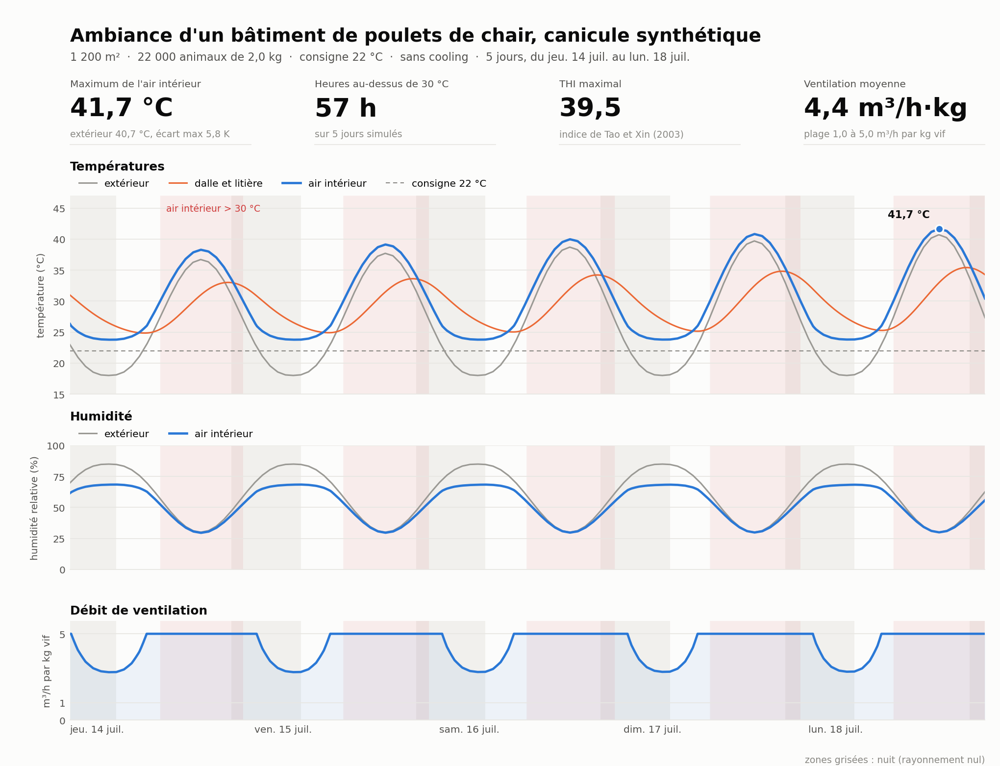

# poulailler-thermique

Modèle thermique dynamique d'un bâtiment de poulets de chair, en Python.
Deux noeuds (l'air et la dalle), un bilan d'humidité et la chaleur des animaux
d'après les formules CIGR. La ventilation et le chauffage sont régulés comme sur un boîtier d'élevage.
En entrée, une météo horaire ; en sortie, la température et l'humidité intérieures, le débit de ventilation
et la puissance de chauffage, minute par minute.

Ce modèle a été développé pour répondre à une question concrète : pendant une canicule comme
celle de juillet 2022, que vaut l'ambiance dans un bâtiment standard de 1200 m²
avec 22 000 poulets de 2 kg, et qu'est-ce que des pads de cooling changent ?




Cinq jours de canicule synthétique, maxima de 37 à 41 °C. Sans cooling,
l'air intérieur dépasse l'extérieur de 1 à 1,5 °C au plus chaud de la journée
(la ventilation est à fond, les animaux ajoutent leur chaleur) et jusqu'à 6 °C
la nuit, quand la ventilation redescend ; il passe 57 h au-dessus de 30 °C.
Les mêmes jours avec des pads à 70 % d'efficacité donnent un maximum intérieur
de 33,2 °C au lieu de 41,7 °C et 31 h au-dessus de 30 °C
(`figures/ambiance_canicule_avec_pads.png`), avec une humidité plus haute,
autour de 63 % l'après-midi contre 34 % sans cooling : c'est le prix du
refroidissement évaporatif.

## Lancer

```
pip install -r requirements.txt
python scripts/simuler.py                          # canicule synthétique, 5 jours
python scripts/simuler.py --pads 0.7               # la même avec cooling
python scripts/simuler.py --tmin 4 --tmax 14 --masse 0.3 --consigne 29 --chauffage 150
python scripts/figures.py                          # régénère les trois figures du dossier figures/
python -m pytest                                   # 17 tests, une seconde
```

Le script joue le premier jour deux fois et jette la première passe, le
temps que la dalle se mette en température. Il affiche un résumé (maximum
intérieur, heures au-dessus de 30 °C, THI maximal, énergie de chauffage) et
écrit la figure dans `figures/`. Le nom du fichier se choisit avec `--figure`.
Les noms et les réglages des trois figures du dépôt sont dans
`scripts/figures.py`.

Pour une vraie météo, `poulailler.meteo.telecharger_open_meteo` va chercher
l'archive ERA5 sur l'API Open-Meteo, sans clé. Rennes pendant la canicule de
juillet 2022 :

```python
from poulailler import meteo
meteo.telecharger_open_meteo(48.11, -1.68, "2022-07-14", "2022-07-20", "meteo/rennes_2022-07.csv")
```

puis `python scripts/simuler.py --meteo meteo/rennes_2022-07.csv`. Le format
du CSV est dans `meteo/canicule_synthetique.csv` : une ligne par heure,
colonnes `temps`, `t_ext` (°C), `hr_ext` (%), `rayonnement` (W/m², global
horizontal).

## Le modèle

Bilan sur l'air intérieur, supposé bien mélangé :

```math
C_a \frac{dT_a}{dt} = Q_s + Q_{ch} + \rho\, c_p\, Q_v \,(T_{in} - T_a) + H_m \,(T_e - T_a) + H_t \,(T_{sa} - T_a) + H_{am} \,(T_m - T_a)
```

$Q_s$ est la chaleur sensible des animaux, $Q_{ch}$ le chauffage, $Q_v$ le débit
de ventilation et $T_{in}$ la température de l'air entrant (l'air extérieur, ou
moins si les pads tournent). $H_m$ et $H_t$ sont les conductances $U \cdot A$ des murs
et du toit. Le toit voit une température sol-air $T_{sa} = T_e + \alpha G / h_{ext}$
qui contient l'apport solaire absorbé par la couverture. $H_{am}$ est l'échange
convectif et radiatif entre l'air et la dalle.

Bilan sur la dalle et la litière, qui font l'inertie :

```math
C_m \frac{dT_m}{dt} = H_{am} \,(T_a - T_m) + H_{ms} \,(T_{sol} - T_m)
```

Bilan d'eau sur l'air intérieur, avec $Q_l$ la chaleur latente des animaux :

```math
\rho\, V \frac{dw}{dt} = \frac{Q_l}{L_v} + \rho\, Q_v \,(w_{in} - w)
```

La chaleur des animaux vient du rapport CIGR de 2002, chapitre poulets de
chair : $10{,}62\, m^{0{,}75}$ W par animal à 20 °C, corrigée en température, avec une
part sensible qui décroît quand il fait chaud. Les formules sont écrites au
niveau du bâtiment, donc l'évaporation de la litière et des abreuvoirs est
déjà dedans.

La régulation est proportionnelle : ventilation de 1 à 5 m³/h par kg vif sur
une bande de 4 K au-dessus de la consigne, chauffage de 0 à la puissance
installée sur 2 K en dessous. Les pads se déclenchent sur la température
intérieure (28 °C par défaut, progressivement sur 2 K, avec un temps de
réponse de 15 min qui tient lieu du cyclage de la pompe) et refroidissent
l'air entrant d'une fraction de l'écart entre température sèche et
température humide ; l'humidité absolue monte d'autant (refroidissement
adiabatique).

Intégration en temps au pas de 60 s. Le noeud air a une constante de temps
de l'ordre de la minute quand la ventilation est à fond, un Euler explicite
y serait instable. Comme les bilans sont linéaires en $T_a$ et en $w$ à
coefficients gelés sur le pas, je les intègre exactement (relaxation
exponentielle vers l'équilibre). La dalle, qui met des heures à bouger, se
contente d'un Euler explicite.

Les valeurs par défaut du bâtiment (80 m × 15 m × 3,5 m, panneaux sandwich à
0,45 W/m²K en murs et 0,35 en toit, dalle à $10^8$ J/K de capacité active)
sont dans `poulailler/batiment.py`, avec un commentaire par paramètre.

## Limites et suites

- L'air est supposé homogène : pas de stratification ni de zone morte. Ce niveau de détail demande une CFD.
- La vitesse d'air sur les animaux n'est pas modélisée. En ventilation tunnel, elle compte beaucoup pour le confort à 33 °C. Le THI calculé l'ignore aussi ; l'indice complet de Tao et Xin (THVI) l'inclut.
- La chaleur animale CIGR est extrapolée au-delà de 30 °C, sans variation jour-nuit ni courbe de croissance.
- Seule la dalle a de l'inertie. C'est défendable pour des murs en panneaux sandwich, pas pour du parpaing.

Les tests vérifient la psychrométrie, les formules CIGR et le respect des bilans en régime permanent, à 1 % près. L'étape suivante est de caler la capacité de la dalle et les conductances sur des mesures d'ambiance en élevage, puis d'ajouter la vitesse d'air pour passer du THI au THVI.

## Références

Pedersen S., Sällvik K. (2002). Heat and moisture production at animal and
house levels. 4th report of the CIGR working group on climatization of
animal houses. Danish Institute of Agricultural Sciences.

Stull R. (2011). Wet-bulb temperature from relative humidity and air
temperature. Journal of Applied Meteorology and Climatology, 50, 2267-2269.

Tao X., Xin H. (2003). Temperature-humidity-velocity index for
market-size broilers. ASAE paper 034037.

Open-Meteo, archive ERA5 : https://open-meteo.com/en/docs/historical-weather-api

## Licence

MIT.
